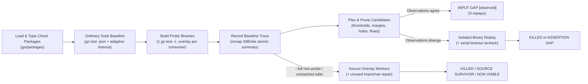

# targeted-mutation-go

[](#quick-start)
[](LICENSE)

**Targeted mutation testing for Go**: `targeted-mutation-go` observes the runtime values your tests pass through comparisons, derives adjacent threshold/margin changes and viable mutations that your suite misses, and verifies copyable Go assertions that catch them.

---

## Why targeted mutation testing?

Conventional Go mutation tools (`gremlins`, `gomutants`, `go-mutants`, `gomu`) apply fixed syntactic rewrites (`>=` → `>`, `+` → `-`, `{ ... }` → `{}`), recompile or re-test per candidate, and report a flat list of `SURVIVED` mutants to diagnose by hand. That workflow leaves three structural gaps:

1. **Syntactic rewrites miss value-level boundary bugs.** Suppose `FreeShipping(price int) bool` checks `price >= 5000`, and tests check `4800` and `5000`. Those two inputs kill `price > 5000` and `price < 5000`—giving a 100% score on conventional boundary operators—yet `price >= 4999` still passes every test. By recording the nearest observed operands and rank distances on each side of a comparison, `targeted-mutation-go` computes the closed interval of undistinguished thresholds (`4801..5000`) or variable-RHS margins (`balance >= price - 1`) in $O(1)$ without an SMT solver or LLM, jumping across impossible bitmask holes to name the exact reachable input.
2. **`SURVIVED` conflates missing inputs with weak assertions.** Along the Reachability–Infection–Propagation–Reveal (RIPR) model, a surviving comparison mutant means either no test passed a distinguishing input (**`INPUT GAP`**) or a comparison result flipped during a test and the suite still passed (**`ASSERTION GAP`**, whether the result was ignored or masked downstream). `targeted-mutation-go` separates the two, isolates up to 32 leaf tests (excluding parent-test setup noise) to identify which ones observed the flipped outcome, and can compile and verify a concrete `if got := ...; got != ...` check against both the original code and the mutant.
3. **Rebuilding per mutant wastes CI time.** Instead of invoking `go test` from scratch for every comparison edit, `targeted-mutation-go` builds **one** instrumented test binary per consumer package via `go test -c -overlay=...`, skips replays whose recorded observations prove identical outcomes, and reuses those same binaries in `--full` mode for eligible integer, float, and string operator, literal-step, and boolean-condition mutations.

| Dimension | Conventional Go mutation tools | `targeted-mutation-go` |
| --- | --- | --- |
| **Boundary & margin discovery** | Fixed token swaps (`>=` → `>`) | Synthesizes nearest reachable integer thresholds, variable-RHS margins (`a >= b - 1`), `len`/`cap` bounds, and float boundaries |
| **Builds for probe sites** | Per-mutant rebuild or overlay run | **1 `-overlay` test binary** per consumer package |
| **Replay pruning** | Evaluates every candidate | Skips provably equivalent mutations; runs **only consumer binaries where observations diverge** |
| **Survivor diagnosis** | Generic `SURVIVED` / `LIVED` | Separates **`INPUT GAP`** (missing boundary input) from **`ASSERTION GAP`** (comparison flipped, tests passed) |
| **Verified test suggestions** | Manual diagnosis | `--verify-witnesses` & `--suggest-assertions` compile and verify ready-to-paste Go checks |
| **Pull request review** | Changed-line filter | `--since REV --undo-changes` reverts tracked Git hunks, AST `&&`/`\|\|` terms, and keyed literal fields (`UNTESTED CHANGE`), and detects **`WEAKENED TEST`** regressions |
| **Dependencies** | Tool-specific runners | Stock Go toolchain (`go` + `golang.org/x/tools/go/packages`), **no AI, no SMT solver** |

---

## Quick start

### Requirements & install

- **Go 1.26 or newer** to build `targeted-mutation-go` on **Linux or macOS** (`GOOS`/`GOARCH` must execute natively on the host; target modules declaring `go 1.18` or newer are supported by probes).
- Run `targeted-mutation-go` only on code you trust: like `go test`, it compiles and executes target packages and tests with your user permissions. Target files in your checkout are never modified; edits and synthetic files live in temporary `go -overlay` directories.

```sh
# From a local checkout:
go install ./cmd/targeted-mutation-go

# Or once published to a module proxy / VCS:
go install github.com/t-k/targeted-mutation-go/cmd/targeted-mutation-go@latest
```

### 1. Find a missing boundary input (`INPUT GAP`)

Initialize a small Go module (`mkdir demo && cd demo && go mod init example.com/checkout`) with `checkout.go` and `checkout_test.go`:

`checkout.go`:

```go
package checkout

func FreeShipping(price int) bool {
	return price >= 5000
}

func Discount(cents, pct int) int {
	return (cents * pct) / 100
}
```

`checkout_test.go`:

```go
package checkout

import "testing"

func TestFreeShipping(t *testing.T) {
	if FreeShipping(4800) {
		t.Fatal("4800 should not qualify")
	}
	if !FreeShipping(5000) {
		t.Fatal("5000 should qualify")
	}
}

func TestDiscount(t *testing.T) {
	if got := Discount(200, 15); got != 30 {
		t.Fatalf("got %d, want 30", got)
	}
}
```

Run `targeted-mutation-go analyze --verify-witnesses ./...`:

```text
$ targeted-mutation-go analyze --verify-witnesses ./...
INPUT GAP checkout.go:4:15
  expression: price >= 5000
  mutation: price >= 4999 [observed]
  observed-equivalent thresholds: 4801..5000
  add a check for FreeShipping(4999) == false (mutant: true) [verified]
    if got := FreeShipping(4999); got != false {
        t.Fatalf("got %v, want false", got)
    }

1 sites, 1 test binaries, 2 probe replays (1 avoided), 0 source runs, 2 killed, 1 survived, 0 unreached, 0 non-viable, 0 incomplete
$ echo $?
2
```

`price > 5000` and `price < 5000` were killed via the prebuilt test binary (`2 killed`), while `price >= 4999` needed **zero** test replays (`1 avoided`) because the recorded extrema (`4800` and `5000`) already prove survival. With `--verify-witnesses`, the suggested check was compiled and run against both the original (`pass`) and the mutant (`fail`). Adding that check to `TestFreeShipping` and re-running yields `0` gaps and exit code `0`.

### 2. Pinpoint a weak test (`ASSERTION GAP`)

If `TestFreeShipping` calls `_ = FreeShipping(5000)` without asserting its return value, `--suggest-assertions` isolates leaf tests, confirms which test observed the flipped comparison without failing, and verifies the missing assertion:

```text
$ targeted-mutation-go analyze --suggest-assertions ./...
ASSERTION GAP checkout.go:4:15
  expression: price >= 5000
  mutation: price > 5000 [replayed]
  add a check for FreeShipping(5000) == true (mutant: false) [verified]
    if got := FreeShipping(5000); got != true {
        t.Fatalf("got %v, want true", got)
    }
  test packages: example.com/checkout
  tests that observed the change: TestFreeShipping
```

### 3. Catch deeper bugs with source mutations & witnesses (`--full`)

Some bugs live outside comparisons—such as integer truncation when dividing before multiplying in `(cents * pct) / 100`, where `Discount(200, 15)` happens to divide evenly (`200 / 100 * 15 == 30`). Passing `--full --verify-witnesses` runs the full source catalogue alongside comparison probes and synthesizes concrete distinguishing calls for surviving source edits:

```text
$ targeted-mutation-go analyze --full --verify-witnesses --lines checkout.go:8 ./...
SOURCE SURVIVOR checkout.go:8:9
  expression: (cents * pct) / 100
  mutation: ((cents / 100) * pct) [source-replay]
  verified with Discount(10, 10) (original 1, mutant 0)
    package checkout

    import "testing"

    func TestTmtSourceWitness45484083435b9b7bf14404dd(t *testing.T) {
        if got := Discount(10, 10); got != 1 {
            t.Fatalf("got %v, want 1", got)
        }
    }
```

---

## Understanding findings & reports

### Finding statuses

| Finding | Status in JSON | Meaning | What to do |
| --- | --- | --- | --- |
| **`INPUT GAP`** | `input-gap` | Observed operands never separate the mutant from the original. Includes `threshold_interval` and a distinguishing operand, call, or variable-RHS margin when derivable. | Add a test exercising the reported boundary input (pass `--verify-survivors` to replay predicted survivors explicitly). |
| **`ASSERTION GAP`** | `assertion-gap` | The mutant flipped a runtime comparison in the listed consumer package(s), yet every selected test still passed. | Tighten assertions in the tests surfaced by `--suggest-assertions`. |
| **`SOURCE SURVIVOR`** | `source-survivor` | A `--full` or `--source-only` edit compiled and passed the selected test suite (or matched recorded comparison observations on reached sites). | Add a test covering the mutated behavior (use `--verify-witnesses` or `--suggest-assertions` to synthesize a witness). |
| **`UNTESTED CHANGE`** | `untested-change` | With `--since REV --undo-changes`, reverting a modified tracked Git hunk or AST sub-hunk still passed all selected tests. | Add a regression test that fails against the pre-PR behavior, or silence intentional refactorings with `// tmt:ignore`. |
| **`WEAKENED TEST`** | `weakened-test` | With `--since REV`, tests changed in the working tree now let a mutation survive (or go unreached) that the `REV` tests killed on current production code. | Restore the lost test coverage from `REV`. |
| **`UNREACHED`** | `unreached` | No selected test executed this comparison site (hidden by default; shown with `--show-unreached`). | Add test coverage that reaches the code path. |
| **`NON VIABLE`** | `non-viable` | Static Go rules or compiler diagnostics reject the candidate edit (counted in `non_viable`; hidden in text output unless `--show-non-viable` is passed). | No action needed. |
| **`UNSTABLE` / `TIMEOUT` / `BUILD ERROR` / `ERROR` / `NOT EVALUATED` / `AUDIT DISAGREEMENT`** | `unstable`, `timeout`, `build-error`, `error`, `not-evaluated`, `audit-disagreement` | Per-candidate evaluation could not establish a sound verdict (e.g., flaky test inventory, unconfirmed timeout, broken previous test baseline, or `--audit` mismatch). Increments `incomplete` and exits `3`. | Fix test nondeterminism, raise `--timeout` / `--build-timeout`, or inspect `detail`. |

Each evaluated finding carries an `evidence` tag in text (`[...]`) and JSON:
- `observed` — proven equivalent on the recorded runtime comparison summary without re-running tests.
- `replayed` — executed against an instrumented `.test` binary with activation and infection flags confirmed in shared memory.
- `source-replay` — compiled and tested in an isolated per-mutant `go test -overlay` run.
- `previous-tests` — compared against test files restored from `--since`.
- `static` — rejected statically without invoking the compiler (for example, emptying a function body whose signature requires return values).

### Impossible-value filtering, inline suppressions & witness synthesis

- **Attainability constraints & hole-jumping:** When the non-constant side of an integer comparison uses bitwise masks (`x & 0xF0`, negative masks like `x & -2`), bit-clear (`x &^ 1`), left shifts (`x << 2`), remainders (`x % 3`, `x % -3`), `len(xs)` / `cap(xs)` (bounded `>= 0`), or nested combinations (`(x & 3) & 8`), the planner computes exact domain bounds and `ZeroBits` and jumps across unreachable holes (`PrevPossible` / `NextPossible`) to propose the nearest reachable threshold (e.g., `(flags & 0xF0) >= 0x20` proposes `16` rather than impossible `31`).
- **Inline suppressions (`// tmt:ignore`):** Place `// tmt:ignore <reason>` or `/* tmt:ignore <reason> */` at the end of a line to suppress findings on that line, or on standalone comment line(s) immediately above a statement to suppress the following line. Suppressed gaps increment `suppressed` (and `survivor_breakdown.suppressed`) and do not trigger exit code `2`.
- **Comparison witnesses (`--verify-witnesses`):** Synthesizes and verifies direct calls for non-generic package functions whose body returns the comparison directly and whose parameters (up to 8) are basic scalars (`bool`, `string`, numeric types).
- **Assertion attribution (`--suggest-assertions`):** Filters out sites touched during package `init` or `TestMain` (via `-test.run=^$`), attributes parent tests directly when setup before `t.Run` already flips the site (`^TestParent$/^$`) rather than falsely attributing sibling subtests, isolates up to **32** leaf tests per assertion gap, and verifies a concrete assertion when callable.
- **Source witnesses (`--verify-witnesses` / `--suggest-assertions`):** Searches up to **80** literal-seeded input combinations (including large integer constants up to $10^9$) across up to **8** surviving AST-screened source edits inside an isolated temporary working directory.

### Exit codes, accounting identities & machine-readable formats

| Exit code | Meaning |
| ---: | --- |
| **`0`** | Complete run with zero unsuppressed test gaps (also `--help`, `version`, and a valid `--list` preview) |
| **`1`** | CLI usage error, empty `--test` match, environment/package-discovery error, or ordinary/instrumented baseline failure |
| **`2`** | Complete run (`incomplete == 0`) with at least one unsuppressed gap (`input-gap`, `assertion-gap`, `source-survivor`, `untested-change`, `weakened-test`) |
| **`3`** | Run completed with `incomplete > 0` (per-candidate `unstable`, unconfirmed `timeout`, `build-error`, `error`, unconfirmed `--since` previous-test comparison, failed witness verification, or `audit-disagreement`) |

Every evaluated JSON report satisfies three accounting identities (with `timed_out` omitted when `0`):
- `mutants_run == killed + survived` (total evaluated verdicts including observation-pruned and checkpoint-resumed mutants; actual executions are reported in `mutation_replays` and `source_runs`)
- `timed_out <= killed` (probe and source mutations confirmed to exceed the test timeout on serial recheck are counted as `killed` and `timed_out`)
- `survived == survivor_breakdown.reported + survivor_breakdown.suppressed`

Format guarantees:
- **Terminal safety:** `text` output and `stderr` strip 7-bit/8-bit ANSI escape sequences (CSI/OSC/DCS/SOS/PM/APC), C0/DEL/C1 control characters, Unicode BiDi directional overrides, and inline line breaks from untrusted project strings, while JSON, JSONL, and SARIF remain lossless.
- **JSON (`--format json`) & JSONL (`--format jsonl`):** Top-level `"schema": 1`. Threshold intervals and witness inputs are base-10 strings to preserve full 64-bit integer precision.
- **SARIF 2.1.0 (`--format sarif`):** Emits `%SRCROOT%`-relative URIs (including sibling `go.work` workspace modules), UTF-16 `startColumn` offsets, rule descriptors, `invocations[].executionSuccessful`, and `partialFingerprints["targetedMutationId/v1"]`.
- **Move-resilient finding IDs:** Hashes `(file, rule, expression, mutation, enclosingFuncAndTrimmedLineAnchor, occurrenceInFile, relativeColumn)` so moving a function within its file or inserting lines above it preserves `--baseline` IDs and `--shard` assignments.

---

## Mutation modes & operator catalogue

| Mode | Flags | What runs |
| --- | --- | --- |
| **Targeted comparisons** *(default)* | *(none)* | Instruments eligible integer comparisons (including `len`/`cap`) and float comparisons (`float32`/`float64`), tests boundary & negation changes, and synthesizes adjacent reachable integer thresholds and variable-RHS margins (`a >= b ± 1`) from runtime observations. |
| **Conventional comparisons** | `--conventional` | Runs syntactic boundary and negation probe mutations without threshold/margin synthesis and without skipping whole mutants predicted to survive (unaffected consumer binaries are still skipped when another consumer diverges). |
| **Full hybrid catalogue** | `--full` | Combines integer, float, and string comparison probes with the full AST source mutation catalogue below, routing probe-compatible operator, literal-step, and boolean edits through prebuilt `.test` binaries before falling back to per-edit overlays. |
| **Source-only** | `--source-only` | Evaluates the full AST mutation catalogue exclusively through isolated per-edit `go test -overlay` runs (supports cgo files and bypasses probe instrumentation). |

### Source mutation catalogue (`--full` and `--source-only`)

| Family | Rules & supported edits |
| --- | --- |
| **Comparisons** | Type-valid relational and equality replacements (`<`, `<=`, `>`, `>=`, `==`, `!=` on ordered types; `==` ↔ `!=` on comparable types) with precedence-preserving grouping variants (`source-operator`, `operator-grouping`) |
| **Arithmetic & bitwise** | `+`, `-`, `*`, `/`, `%` (excluding `+`/`-` → `%`), `&`, `\|`, `^`, `&^`, `<<` ↔ `>>`, compound assignments (`+=`, `-=`, `*=`, `/=`, `%=`, `&=`, `\|=`, `^=`, `&^=`, `<<=`, `>>=`) plus replacement with plain `=`, unary `+` ↔ `-`, unary `^x` → `&x` when type-valid, `++` ↔ `--` |
| **Conditions & control flow** | Logical `&&` ↔ `\|\|`, `&&`/`\|\|` individual operand replacement (`boolean-operand`), unary `!x` → `x` (`remove-not`), `if`/`for` condition forced `true`/`false` (`condition-constant`) and `!(cond)` (`condition-negation`), `break` ↔ `continue`, early `break` in `for ... range` (`range-break`), emptying non-empty blocks (`empty-block`) and `switch`/`select` clauses (`empty-case`) |
| **Literals & returns** | Integer literals `±1` (`integer-step`), float literals `±1.0` (`float-step`), string literals (`""` → `"mutated"`, non-empty → `""`; `string-literal`), `true` ↔ `false` (`boolean-literal`), return value replacements with `true`/`false` (`return-boolean`), `0`/`""`/typed zero (`return-zero`), and `nil` (`return-nil`) |
| **Errors & statements** | `err != nil` → `false` (`error-check`), `fmt.Errorf` / `*Errorf` `"%w"` → `"%v"` (`errorf-unwrap`), standalone expression/`defer`/`go`/`<-`/assignment/`++`/`--` statement removal (`statement-remove`), and blanking assignment LHS `x = rhs` → `_ = rhs` (`discard-assignment`) |
| **Standard library & numeric intent** | Built-in `min` ↔ `max`, `math.Min` ↔ `Max`, `slices.Min` ↔ `Max` / `MinFunc` ↔ `MaxFunc` (`min-max`); `math.Floor`/`Ceil`/`Round`/`RoundToEven`/`Trunc` swaps (`rounding-mode`); `strings` & `bytes` `HasPrefix`/`HasSuffix` → `Contains` (`affix-contains`), `TrimPrefix` ↔ `TrimSuffix` & `CutPrefix` ↔ `CutSuffix` (`affix-end`), `Index`/`IndexByte`/`IndexAny` ↔ `LastIndex*` (`search-direction`), `Replace(..., 1)` ↔ `ReplaceAll(...)` (`replacement-count`); `slices.Contains`/`Index` 2–8 element scalar literal pruning (`slice-element-remove`); `(a * b) / c` → `((a / c) * b)` and `(a * (b / c))` (`integer-rounding-order`) |

Operator coverage and verdicts were validated against **Gremlins 0.6.0**, **gomutants 0.7.3**, **gomu 0.3.0**, and **go-mutants 0.1.2** on a recorded peer fixture (`benchmarks/peer_parity.py`)—see [benchmarks/README.md](benchmarks/README.md).

---

## Pull requests & CI workflows

### Common recipes

```sh
# Pull request gate: changed lines, hunk/sub-hunk reverts, weakened-test detection, and assertion suggestions
base=$(git merge-base HEAD origin/main)
targeted-mutation-go analyze --full --suggest-assertions --since "$base" --undo-changes ./...

# Target specific lines in one package while running integration tests from another package
targeted-mutation-go analyze --lines internal/price/rates.go:40-80 --test-package ./integration/... --test '^TestRates$' ./internal/price

# Incremental adoption: record existing gaps once, then block only new gaps in CI
targeted-mutation-go analyze --full --write-baseline .tmt-baseline.json ./...
targeted-mutation-go analyze --full --baseline .tmt-baseline.json --format sarif ./... > tmt.sarif

# Deterministic 4-way CI sharding (preview candidates with --list, or evaluate shard 0 of 4)
targeted-mutation-go analyze --full --shard 0/4 --format jsonl ./...

# Resumable long campaign with crash-safe checkpoint journal and probe-vs-source self-audit
targeted-mutation-go analyze --full --checkpoint .tmt-campaign.jsonl --audit 5 ./...
```

### How `--since` and `--undo-changes` work on pull requests

- **Diff-scoped findings (`--since REV`):** Restricts ordinary findings and summary counters to full AST spans intersecting changed lines in tracked `.go` files plus untracked `.go` files (intersected with `--lines` when both are given).
- **Hunk & sub-hunk reversion (`--undo-changes`):** For modified tracked production `.go` files (excluding newly added `/dev/null` files and untracked files), restores each changed Git hunk to `REV`. Where an edited expression retains a byte-exact surrounding prefix or suffix anchor against `REV`, multi-addition edits are also split into independent AST sub-hunks—removing individual added `&&` / `||` clauses and added `Key: Value` fields in composite literals—reporting `UNTESTED CHANGE` if the suite still passes.
- **Weakened-test detection (`--since REV`):** When any selected `*_test.go` file was modified, added, or deleted since `REV` (even if an entire test package directory was deleted), surviving and newly unreached mutations in unchanged production code are replayed against the `REV` tests overlaid onto the current production source. Any mutant that `REV` tests killed is flagged as `WEAKENED TEST`.

### CLI option reference

Flags and package patterns may appear in any order (`targeted-mutation-go analyze [flags] [packages...]`; patterns default to `./...`, and `--` ends flag parsing). Long-running phases emit periodic 5-second progress summaries to `stderr` without affecting `stdout`.

#### Target & Scope

| Flag | Default | Description |
| --- | --- | --- |
| `--dir <DIR>` | `.` | Project or Go workspace directory |
| `--since <REV>` | — | Restrict ordinary findings to lines changed since Git `<REV>` and check modified tests for weakening |
| `--undo-changes` | `false` | Restore modified tracked Go hunks and matched AST sub-hunks to `--since` (requires `--since`) |
| `--lines <SPEC>` | — | Restrict mutations to `FILE`, `FILE:LINE`, or `FILE:FROM-TO` (repeatable; intersects `--since`) |
| `--test-package <PKG>` | target patterns | Independent Go package pattern(s) to execute as the test suite (repeatable; unimported targets are still compile-checked) |
| `--test <REGEX>` | — | Filter tests and subtests via Go's `-run` regular expression (errors if zero tests match) |
| `--tags <TAGS>` | — | Comma-separated Go build tags passed to package loading, builds, and `go test` |
| `--include-generated` | `false` | Also discover mutations in files carrying standard `// Code generated ... DO NOT EDIT.` headers |

#### Mutation Modes & Filtering

| Flag | Default | Description |
| --- | --- | --- |
| `--full` | `false` | Run comparison probes together with the full source mutation catalogue |
| `--source-only` | `false` | Run the full catalogue exclusively via isolated per-edit source overlays |
| `--conventional` | `false` | Disable threshold/margin synthesis and predicted-survivor whole-mutant skipping (incompatible with `--verify-witnesses`) |
| `--comparison <KIND>` | `all` | Filter comparison probe candidates (`all`, `boundary`, or `negation`) |
| `--exclude-rule <RULE>` | — | Exclude a specific rule name such as `negation`, `margin`, `empty-block`, or `integer-step` (repeatable) |
| `--list` | `false` | Preview candidate mutations without compiling or running tests (incompatible with `--baseline`, `--write-baseline`, `--checkpoint`, and `--audit`) |

#### Verification & Suggestions

| Flag | Default | Description |
| --- | --- | --- |
| `--verify-survivors` | `false` | Replay comparison mutations whose recorded observations already predict survival |
| `--verify-witnesses` | `false` | Compile and run synthesized witness tests for direct comparison calls and surviving source edits (incompatible with `--conventional`) |
| `--suggest-assertions` | `false` | Isolate tests for `ASSERTION GAP`s and verify concrete assertions (also runs source witnesses) |
| `--audit <N>` | `0` | Rebuild up to `<N>` completed probe mutations as actual source edits and verify verdict agreement (requires probe execution; incompatible with `--source-only` and `--list`) |

#### Output, Baselines, Sharding & Execution

| Flag | Default | Description |
| --- | --- | --- |
| `--format <FMT>` | `text` | Output format: `text`, `json`, `jsonl`, or `sarif` |
| `--show-unreached` | `false` | Include comparison sites not executed by any selected test binary |
| `--show-killed` | `false` | Include `killed` mutations in the findings list |
| `--show-non-viable` | `false` | Include `non-viable` candidates in `text` output |
| `--baseline <FILE>` | — | Suppress known gap IDs listed in `<FILE>` from output and exit status |
| `--write-baseline <FILE>` | — | Atomically write current gap IDs from a complete campaign (`incomplete == 0`) to `<FILE>` |
| `--shard <K/N>` | — | Deterministically assign candidate IDs to zero-based shard `K` of `N` (`0 <= K < N`) |
| `--checkpoint <FILE>` | — | Lock and resume completed verdicts from a crash-safe JSONL journal when the campaign fingerprint matches |
| `--jobs <N>` | `min(4, GOMAXPROCS)` | Maximum concurrent build or mutation worker goroutines (automatically budgets per-worker `GOMAXPROCS` when `N > 1`) |
| `--timeout <DUR>` | `5s + 5×test_runtime` | Per-test-package timeout derived from pure baseline test execution time (warns on stderr if baseline test runtime meets or exceeds an explicit `--timeout`) |
| `--timeout-recheck <MODE>` | `serial` | Recheck parallel worker timeouts serially (`serial`) or leave unconfirmed (`none`) |
| `--build-timeout <DUR>` | `5m` | Timeout per `go test`, `go list`, or `go test -c` build command |

---

## How it works



1. **Typed package discovery.** Loads target packages with `golang.org/x/tools/go/packages` under the active build tags and `GOOS`/`GOARCH`. Integer comparisons (including named integer types, `int`/`uint`/`uintptr`, and built-in `len`/`cap`) and float comparisons (`float32`/`float64`) are instrumented where evaluation order cannot change; `--full` additionally instruments string comparisons. Synthetic probe files are named to sort before all package `.go` files and use zero-initialized lazy state so Go package-level `var` initialization order is never altered.
2. **Dual baseline verification & adaptive timeout.** Runs `go test -json -count=1` (including default `go vet`), derives an adaptive per-package timeout (`5s + 5×test_runtime` from `go test -json` package execution durations when `--timeout` is unset), compiles one instrumented `.test` binary per non-skipped consumer package inside a temporary `go -overlay`, and verifies identical test inventories.
3. **Lock-free shared-memory tracing.** During the baseline run, each comparison site updates a 40-byte `mmap` slot (`Flags` including IEEE-754 `Unordered` bit `32` for `NaN`, `Below`, `~Above`, `~BelowGap`, `~AboveGap`) using Go 1.18-compatible `sync/atomic` compare-and-swap loops, mapping signed integers to monotonic `uint64` ranks via `uint64(v) ^ (1 << 63)`.
4. **Interval/margin planning, verified activation & process cleanup.** From recorded extrema and rank gaps, the planner computes observation-equivalent threshold intervals (clamped to attainable bounds and jumping across impossible bitmask holes and exact small-modulus remainders) and overflow-free variable-RHS margins (`a >= b ± 1`), skipping provable survivors (`observed`). Remaining candidates run with `-failfast` in dedicated process groups (`Setpgid`) with private `mmap` traces; process groups (`pid > 1`) are terminated (`SIGKILL`) after every normal or timed-out exit. Parallel timeouts are rechecked serially (`--timeout-recheck serial`), and confirmed probe and source test timeouts are counted as `killed` (`timed_out`).
5. **Hybrid `--full` routing, equivalent-bound pruning & source repair.** Reached `--full` comparison operator swaps (excluding provably equivalent minimum-bound swaps such as `s == ""` → `s <= ""` or `len(x) != 0` → `len(x) > 0`, and excluding struct reflection tags), `±1` literal steps, `!(cond)` negations (excluding ordered float comparisons where `NaN` semantics differ), and side-effect-free `true`/`false` comparison replacements reuse prebuilt probe binaries, falling back to isolated source overlays when unreached or unconfirmed. Source overlays retry once when an edit leaves an unused local variable (`_ = &x`) or import (`_ "pkg"`).

---

## Performance, soundness & limits

### Recorded benchmark summary

Full methodology, peer versions, and raw timing distributions on macOS arm64 (Go 1.26.10, 4 workers, 5 measured rounds after warm-up) are documented in [benchmarks/README.md](benchmarks/README.md):

- **24-site integer boundary suite (`--comparison=boundary`):** `targeted-mutation-go` finishes in **2.49 s** (default observation pruning, 0 mutation replays) and **1.89 s** (`--comparison=boundary --conventional`, 24 binary replays) end-to-end including baseline and build, compared with **6.53 s** (`go-mutants 0.1.2`), **6.63 s** (`gremlins 0.6.0`), and **10.26 s** (`gomutants 0.7.3`) configured for the identical 24 boundary mutations.
- **Hybrid `--full` probe routing:** Routing eligible `--full` comparison, literal-step, and boolean edits through prebuilt probe binaries reduces wall time on the 8-comparison full-catalogue fixture from **13.17 s to 1.61 s** (`go test` source runs reduced from **64 to 0**) while matching `--source-only` verdicts across all compared source-catalogue edits.
- **Lazy source-queue memory:** Sharing immutable file snapshots across workers reduces queuing 1,024 source edits on a 64 KiB file from **~64 MiB to 1.03 MiB**.

### Soundness assumptions & known limits

- **Deterministic tests:** Observation-based pruning (`observed`) assumes deterministic test execution for the selected build configuration. Nondeterministic replays are flagged as `UNSTABLE` (exit `3`); pass `--verify-survivors` to force binary replays or `--audit N` to cross-check probe verdicts against real source edits.
- **Conservative probe placement:** Statements containing general function or method calls (other than type conversions and built-in `len`/`cap` on side-effect-free operands), channel receives (`<-ch`), closures, compiler directives (`//go:...`), compile-time constant expressions, array-length `range` loops without a value variable, generated files (unless `--include-generated`), and cgo-transformed files are left out of probe rewriting so evaluation order and compile-time semantics never change. Pass `--full` or `--source-only` to cover general call-bearing expressions and cgo packages via source overlays. Float probes test boundary (`<` ↔ `<=`, `>` ↔ `>=`) and negation changes rather than ULP-level threshold shifts.
- **Environment & workspace rules:** Native probe `mmap` execution requires Linux or macOS. Subprocesses strip `TMT_GO_TRACE` and `TMT_GO_MUTATION` during builds, and tests that scrub their own environment before re-executing the test binary should use `--source-only`. Only compatible flags (`-a`, `-asan`, `-buildvcs`, `-msan`, `-p`, `-race`, `-tags`, `-trimpath`, `-mod=readonly`, `-mod=vendor`) are accepted in `GOFLAGS`; pass `-tags` and `-timeout` via CLI flags. At a `go.work` root that has no root `go.mod`, pass explicit module patterns such as `./app/... ./lib/...`.
- **Checkpoint invalidation:** `--checkpoint` hashes the `targeted-mutation-go` binary, CLI flags, Go toolchain/environment, `--since` commit, workspace files (handling symlinks and ignoring `.git`, `.worktree`, `node_modules`, and `docs.local`), and `go list -deps -test` inputs, with sorted baseline test inventories so `t.Parallel()` ordering never invalidates cached verdicts.

---

## Development & formal verification

CI ([.github/workflows/ci.yml](.github/workflows/ci.yml)) runs `go test`, `go vet`, and `go test -race` across Go 1.26 and 1.27 on Ubuntu and macOS (plus self-mutation gating on Ubuntu / Go 1.27), alongside a dedicated Ubuntu formal-verification job for Lean 4, TLC, and PICT:

- **Lean 4** ([verification/lean/Threshold.lean](verification/lean/Threshold.lean)): proves adjacent-threshold distinguishing ranks, observation-extremum sufficiency, two's-complement sign-bit ranking (`x + 2^63`) and overflow-free rank differences, 3-bit comparison masks under operand reversal, bitmask zero-bits, $O(1)$ `prevMaskedStep` / `nextMaskedStep` hole-jumping exactness, and signed/unsigned remainder bounds.
- **TLA+ / TLC** ([verification/tla/](verification/tla/) & [internal/reporting/formal/](internal/reporting/formal/)): model-checks worker concurrency and activation evidence (`Campaign.tla`), hybrid probe/source fallback and bounded repair retries (`SourceReplay.tla`), crash-safe locked checkpoint journals (`Checkpoint.tla`), isolated test attribution (`Suggestion.tla`), 4-step source witness verification (`SourceWitness.tla`), previous-test comparison (`Weakened.tla`), and atomic baseline publication (`BaselineSnapshot.tla`).
- **Combinatorial & self-mutation testing:** 18 PICT models ([verification/pict/](verification/pict/)) verified for exhaustive pairwise + seed coverage by `scripts/check-pict.py`, plus planner self-mutation gating via `scripts/check-mutants.py`.

```sh
go test -count=1 ./...
go vet ./...
go test -race -count=1 ./...
python3 scripts/check-pict.py
python3 scripts/check-mutants.py
lean +leanprover/lean4:v4.36.0 verification/lean/Threshold.lean
for model in Campaign SourceReplay Checkpoint Suggestion SourceWitness Weakened; do
  tla2tools -workers 2 "verification/tla/$model.tla"
done
tla2tools -workers 2 -config internal/reporting/formal/BaselineSnapshot.cfg internal/reporting/formal/BaselineSnapshot.tla
```

## Related implementations & prior work

This project is the Go sibling of:
- **Rust (`cargo tmt`):** [github.com/t-k/targeted-mutation](https://github.com/t-k/targeted-mutation)
- **JavaScript / TypeScript (`targeted-mutation`):** [github.com/t-k/targeted-mutation-ts](https://github.com/t-k/targeted-mutation-ts)

Generating mutants from runtime test observations is known in the literature as *test-aware mutant generation*, alongside related lines of work such as SEMu (symbolic execution for surviving mutants), DSpot (assertion amplification), the W-method (distinguishing sequences for finite state machines), and Meta's ACH. `targeted-mutation-go` occupies the **SMT-solver-free, AI-free** corner of that design space: record compact runtime extrema and compute open boundary intervals directly.

## License

Licensed under the [Apache License, Version 2.0](LICENSE).
